# TAREA 1.1

1.Instala o servidor BIND9 no equipo darthvader. Comproba que xa funciona coma servidor DNS caché pegando no documento de entrega a saída deste comando dig @localhost xunta.gal 

Esta es la salida que devolvió el comando:

Se puede ver que en el primer dig el Query Time fue de 419 ms y en cambio en el segundo fue de 1ms. Eso quiere decir que el servidor DNS está configurado en modo caché. Esto se debe a que en la primera isntrucción el servicio DNS fue a preguntar a Internet, y en la segunda respondió desde la memoria.

---

5.Comproba que podes resolver os distintos rexistros de recursos. Pega no documento de entrega a saída dos comandos:

nslookup darthvader.starwars.lan

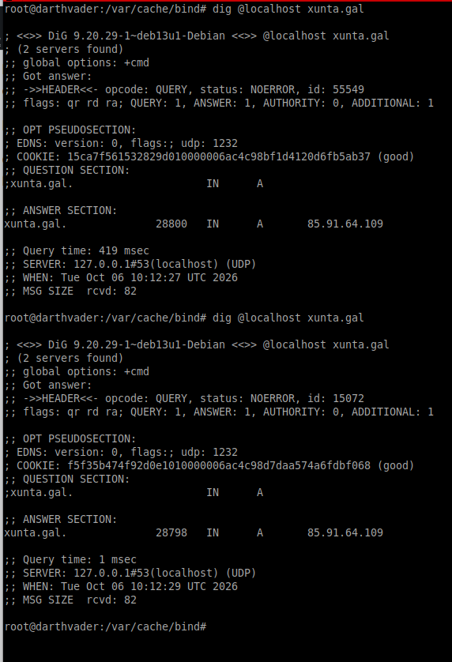

nslookup skywalker.starwars.lan

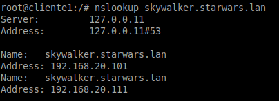

nslookup starwars.lan

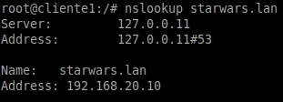

nslookup -q=mx starwars.lan

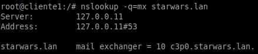

nslookup -q=ns starwars.lan

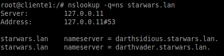

nslookup -q=soa starwars.lan

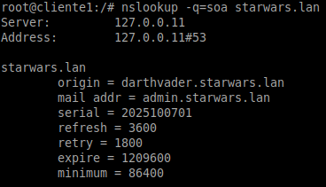

nslookup -q=txt lenda.starwars.lan

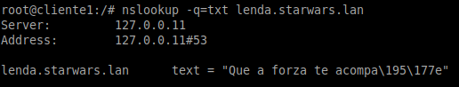

nslookup 192.168.20.11

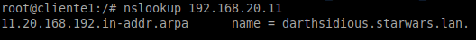

# TAREA 1.3

### PUNTO 1

named.conf.local de darthsidious:

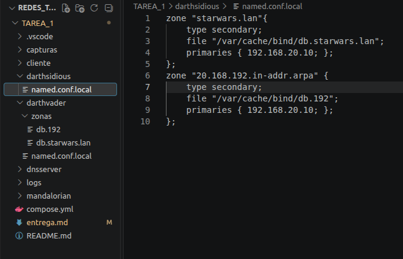

Tomaremos a máquina darthsidious, e configuraremola para ser servidor secundario, tanto da zona primaria de resolución directa como de resolución inversa. Captura os ficheiros de configuración en ambalas dúas máquinas. Fai unha captura onde se vexa o reinicio da máquina darthsidious, no que se vexa no log dos dous equipos e que se fixo a transferencia de zona.

named.conf.local de darthvader:

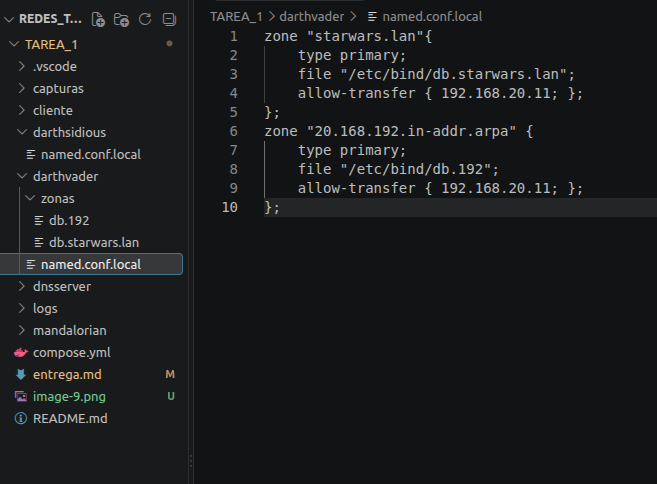

Logs de darthsidious donde se ve que se transferiron as zonas:

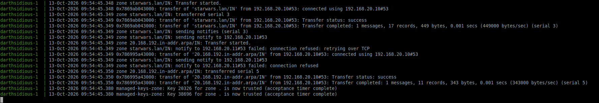

### PUNTO 2

Engade un rexistro tipo A (Chewbacca 192.168.20.28) na zona de resolución directa e tamén na de resolución inversa.  Fai unha captura no momento do reinicio do equipo darthvader, no que se vexa o log dos dous equipos e que se amose que se fixo a transferencia de zona. Adxunta tamén unha captura do ficheiro de zona no servidor secundario.

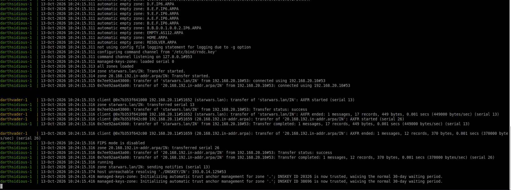

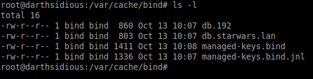

### PUNTO 3

Comproba que o servidor secundario pode resolver ese nome.

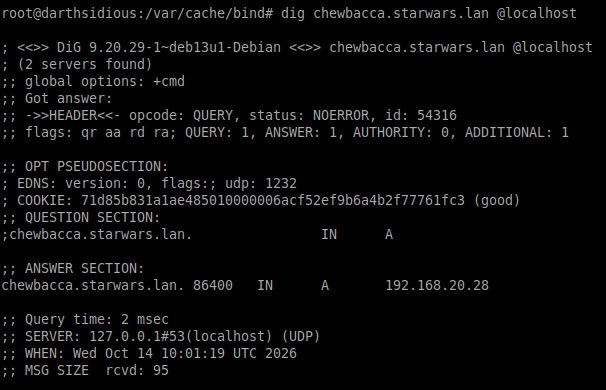

### PUNTO 4

Fai os cambios necesarios para que as trasferencias se fagan de forma segura empregando chaves.  Repite as capturas e vídeos do punto 2, engadindo o rexistro r2d2 (192.168.20.29)

Zons db.starwars.lan

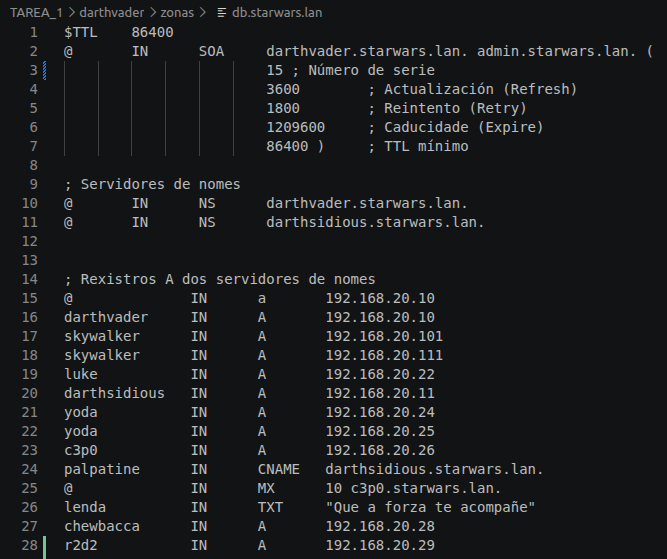

Zona db.192

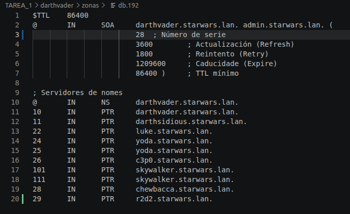

Transferencias de zonas coas chaves

docker logs -f tarea_1-darthvader-1

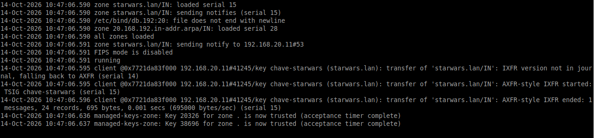

docker logs -f tarea_1-darthsidious-1

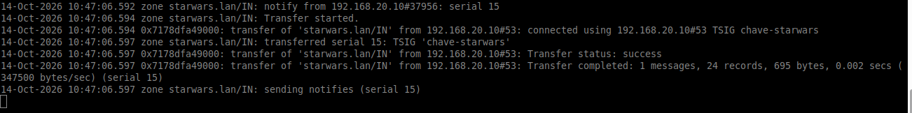